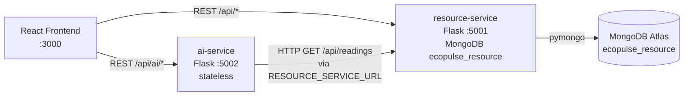

# Architecture — EcoPulse (Module 1, binding)

## System diagram

## Service responsibilities

| Service | Owns | Must NOT do |
|---------|------|-------------|
| `resource-service` (:5001) | All MongoDB access; CRUD for buildings, readings, issues; `GET /api/dashboard/summary` aggregation | Call ai-service; embed ML logic |
| `ai-service` (:5002) | Anomaly detection, forecasting, recommendations, insights (heuristic/statistical, no external LLM required) | Connect to MongoDB directly (no `MONGO_URI`, no `pymongo`); invent readings — always fetch via HTTP |
| `frontend` (:3000) | Dashboard, charts, building pages, issue reporting; calls both services via `REACT_APP_*` URLs | Talk to MongoDB; hardcode `localhost` URLs in source (use env) |

## Ports (binding)

| Component | Port | Health check |
|-----------|------|--------------|
| resource-service | 5001 | `GET /api/health` |
| ai-service | 5002 | `GET /api/health` |
| frontend (dev) | 3000 | — |

## No-direct-DB rule (binding, enforced in review + tests)

1. Only `resource-service` may import `pymongo` / read `MONGO_URI` / `DB_NAME`.
2. `ai-service` reads `RESOURCE_SERVICE_URL` and calls e.g.
   `GET {RESOURCE_SERVICE_URL}/api/readings?building_id=...&resource_type=...&limit=500`.
3. `ai-service` MUST propagate a `502` with envelope error code `UPSTREAM_ERROR`
   when resource-service is unreachable (see `api-contracts.md`).
4. `services/ai-service/requirements.txt` MUST NOT contain `pymongo` (checked in Module 3 review).

## Request flow examples

- Dashboard load: `FE -> RS: GET /api/dashboard/summary` + `FE -> AI: GET /api/ai/insights?building_id=...`
- Forecast chart: `FE -> AI: GET /api/ai/forecast?...` then `AI -> RS: GET /api/readings?...`, compute, return.

## CORS

- Both Flask services enable CORS open for the frontend origin:
  local `http://localhost:3000`, deployed Vercel/Netlify URL (see `deployment-guide.md`).
- No auth in Modules 1–5 (campus demo). `reported_by` on issues is a free-text name.

## Dates / units

- All timestamps ISO8601 UTC (e.g. `2026-10-01T08:00:00Z`).
- Units: electricity `kWh`, water `L`, waste `kg` (see `data-models.md`).
